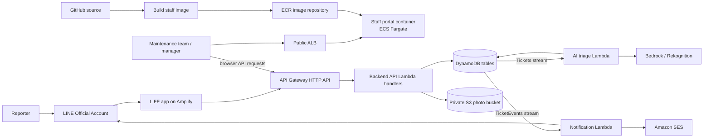
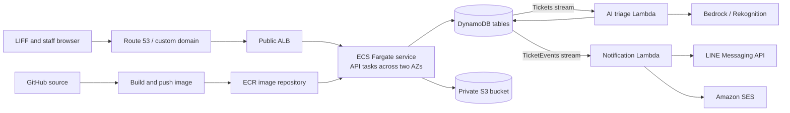

# Deployment topology decision

The original sketch proposed ECR, ECS/Fargate, an Application Load Balancer (ALB), API Gateway, Lambda, DynamoDB, S3, Bedrock, and EventBridge in two Availability Zones. It expresses a reasonable goal: a scalable containerized backend. The deployable IaC in this repository currently uses Lambda for the HTTP API and for background workers. This document separates the container option from that current implementation so the report can describe exactly what is deployed.

## Provisional hybrid design if the staff portal qualifies for the container bonus

The staff container serves the frontend; browser requests still reach API Gateway and the Lambda backend. The existing Lambda handlers need no container HTTP-server conversion for this option. The portal needs a container build, a running ECS service, an ALB or another HTTPS entry point, and its origin in API Gateway CORS. Only the LIFF Amplify app is deployed at present; this diagram is a **plan**, not an as-built claim. Confirm with the professor that a deployed staff portal container earns the special points before adding the ECS resources.

## If the backend API runs in ECS

ECR stores built container images, while GitHub stores source code. ECS runs the image as Fargate tasks. An ALB routes requests to healthy tasks; ECS Service Auto Scaling can adjust task count using CPU, memory, or ALB requests per target. A public ALB can serve the API directly. If API Gateway is required as the public entry point, use a **private ALB plus API Gateway VPC link** and explicitly configure the extra routing and cost. The ALB and API Gateway should not both be shown as unrelated public entry points.

The ECS tasks run in subnets. ECR, DynamoDB, S3, Bedrock, and EventBridge are regional managed services, not copies inside each Availability Zone. The backend accesses them through AWS APIs. DynamoDB Streams can invoke the existing triage and notification Lambdas directly; EventBridge is only needed for a separate scheduled or routed workflow, such as an SLA timer.

Private Fargate tasks need outbound connectivity for pulling images and calling services. NAT gateways have an hourly and data-processing charge. VPC endpoints can cover some AWS services, but the backend's LINE calls still need an internet route. Keep the Lambda workers outside the project VPC unless they need private resources; otherwise their LINE calls also need configured egress. An always-on ECS service and ALB incur charges even with no reports, so estimate this topology against the G02 credit before deployment.

## Changes required before ECS can replace the API Lambda

1. Build a persistent HTTP server that exposes the OpenAPI routes and reuses the ticket logic. `backend/src/local.ts` currently serves only `/health`; the existing ticket handler accepts an API Gateway payload-v2 event, not a Node HTTP request.
2. Add a backend Dockerfile, local container smoke test, and CI build/push workflow. Create an ECR repository and a versioned image deployment; do not use an untracked `latest` image for releases.
3. Add VPC, subnets, security groups, ECS cluster/service/task definition, ALB target group and health check, task execution role, and scoped task role. Add autoscaling only after the service has metrics and a load test.
4. Choose one public API entry path and configure HTTPS, DNS, rate limiting, CORS, and authentication for it. The current HTTP API routes cannot simultaneously remain the production path without routing them to ECS.
5. Preserve the DynamoDB/S3 resources and the stream-driven Lambda workers; they do not need to move into ECS just because the synchronous API does.

## Current decision

The CDK stack under `infrastructure/aws` is a low-cost development slice, **not** an ECS implementation. It has not been deployed. The team should choose whether ECS is required for the backend API, only for the staff portal course bonus, or for neither before adding an ECS stack.

## Recommendation for the current stage

Use API Gateway HTTP API and Lambda for the backend API, the existing stream-triggered Lambdas for triage and notifications, and static hosting for the LIFF and staff frontends. This matches the code already written and limits idle infrastructure cost while the API and tests are incomplete. Revisit ECS only when the course rubric requires a container deployment or a measured load test shows a sustained workload that benefits from always-running tasks. If the ECS bonus applies to the staff portal, containerize that separately after the portal has working routes; do not move the backend API solely to justify a container.
